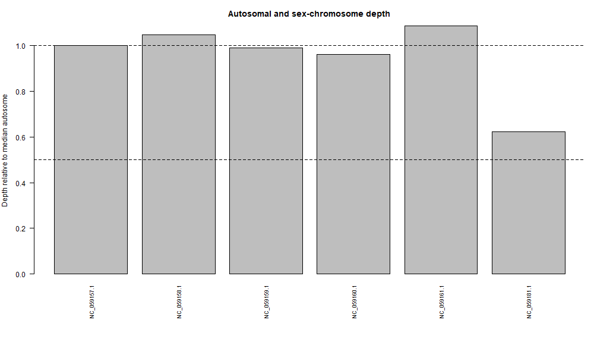

# Sex-Chromosome Dosage in a Selected Animal Nuclear Genome
### Using NCBI, Galaxy, and R

**Laboratory:** Cell and Molecular Biology  
**Selected Species:** *Bubalus bubalis* (Water Buffalo/Carabao)  
**Sex-Chromosome System:** XX/XY  
**Analysis:** Whole-Genome Sequencing Read-Depth Analysis

## Selected Species & Study Question

- **Species:** *Bubalus bubalis* (Water Buffalo/Carabao)
- **Study Question:** Can whole-genome sequencing (WGS) read-depth mapping determine the sex-chromosome complement of a *Bubalus bubalis* individual using chromosome coverage ratios?

This study examined X-chromosome coverage relative to the median autosomal depth to evaluate whether the sequencing data support an XX-like or XY-like dosage pattern.

## Accession IDs

- **Reference Assembly:** [GCF_019923935.1](https://www.ncbi.nlm.nih.gov/datasets/genome/GCF_019923935.1/)
- **Assembly Name:** NDDB_SH_1
- **Assembly BioSample:** [SAMN11104991](https://www.ncbi.nlm.nih.gov/biosample/SAMN11104991)
- **WGS Run Accession:** [SRR27345303](https://www.ncbi.nlm.nih.gov/sra/?term=SRR27345303)
- **WGS BioSample:** [SAMN39114650](https://www.ncbi.nlm.nih.gov/biosample/SAMN39114650)
- **Same Donor:** No
- **Recorded WGS Donor Sex:** Male

The reference genome and WGS reads originated from different BioSamples. Therefore, the dosage analysis refers specifically to the WGS donor.

## Chromosome Groups & Selection (`chromosome_groups.csv`)

Five annotated autosomes and one X chromosome were selected for the read-depth analysis.

| Chromosome | Reference Accession | Group |
|---|---|---|
| Autosome 1 | NC_059157.1 | A |
| Autosome 2 | NC_059158.1 | A |
| Autosome 3 | NC_059159.1 | A |
| Autosome 4 | NC_059160.1 | A |
| Autosome 5 | NC_059161.1 | A |
| X Chromosome | NC_059181.1 | X |

- **Autosomes (Group A):** Five annotated autosomes were selected to establish the median autosomal read-depth baseline.
- **X Chromosome (Group X):** The annotated X chromosome was used to calculate the X-to-autosome (X:A) coverage ratio.
- **Exclusions:** Mitochondrial DNA, unplaced scaffolds, and other non-target sequences were excluded from the normalization analysis.

Chromosome identities were verified using the NCBI assembly sequence report and matched with the reference names in the Samtools coverage table.

## Results Summary

| Parameter | Result |
|---|---|
| Median autosomal depth | 0.722326 |
| X chromosome mean depth | Approximately 0.450 |
| X:A ratio | Approximately 0.622 |
| Y:A ratio | NA |
| Preliminary dosage pattern | XY-like |
| Final interpretation | Inconclusive: very low autosomal depth |

### Chromosome Relative-Depth Visualization

The X:A ratio suggests an XY-like dosage pattern, which is consistent with the recorded male WGS donor. However, the median autosomal depth was below 1, so the laboratory R script classified the final inference as inconclusive due to very low sequencing depth.

## Questions for the Report

### 1. What species did you choose, and what evidence supports a diploid XX/XY or ZZ/ZW system?

**Answer:** The selected species was *Bubalus bubalis*, commonly known as the water buffalo or carabao. It is a diploid mammalian species with an XX/XY sex-chromosome system, where females typically possess two X chromosomes and males possess one X and one Y chromosome. The NCBI chromosome-level reference assembly also contains an annotated X chromosome (`NC_059181.1`), supporting its suitability for sex-chromosome dosage analysis.

### 2. What are your assembly accession, WGS run, and both BioSample accessions? Are the donors the same?

**Answer:** The reference assembly accession was `GCF_019923935.1`, associated with BioSample `SAMN11104991`. The WGS run accession was `SRR27345303`, associated with BioSample `SAMN39114650`. The donors were not the same because the reference assembly and sequencing reads originated from different individuals. Therefore, the sex-chromosome dosage inference refers to the WGS donor.

### 3. Which sequences were used as autosomes and as X or Z? How did you verify their identities?

**Answer:** Five autosomal sequences (`NC_059157.1`, `NC_059158.1`, `NC_059159.1`, `NC_059160.1`, and `NC_059161.1`) were labeled as Group A. The X chromosome (`NC_059181.1`) was labeled as Group X. These identifiers were verified using the NCBI assembly sequence report and matched with the chromosome names in the Samtools coverage output. Mitochondrial DNA and other non-target sequences were excluded.

### 4. What are the median autosomal depth, X:A or Z:A ratio, and inferred sex-chromosome complement?

**Answer:** The median autosomal depth was approximately **0.722326**, and the calculated X:A ratio was approximately **0.622**. The ratio falls within the XY-like range specified in the laboratory script. However, because the median autosomal depth was below 1, the final interpretation was **"Inconclusive: very low autosomal depth."** Thus, the observed pattern suggests an XY-like complement but does not support a confident inference.

### 5. Does your result agree with the recorded sex of the WGS donor, if reported? Explain any discrepancy or uncertainty.

**Answer:** The WGS donor was recorded as male, which is consistent with the preliminary XY-like dosage pattern. However, the low autosomal sequencing depth limits the reliability of the result. Although the ratio agrees with the recorded donor sex, the final inference remains inconclusive because the available sequencing depth is insufficient for a confident classification.

### 6. Why is a chromosome-level assembly alone insufficient for a reliable read-depth sex inference?

**Answer:** A chromosome-level assembly identifies reference chromosome sequences but does not provide the sequencing coverage needed to determine chromosome dosage in the WGS donor. Read-depth analysis requires WGS reads to be aligned to the reference genome so that the relative coverage of autosomes and sex chromosomes can be compared. Therefore, chromosome lengths or the assembly FASTA alone cannot reliably determine whether an individual has an XX-like or XY-like sex-chromosome complement.

## Limitations

- Low autosomal sequencing depth reduced confidence in the dosage interpretation.
- Only five autosomes were used for normalization, following the laboratory's minimum requirement.
- Repetitive sequences and mapping bias may influence chromosome coverage estimates.
- The reference assembly and WGS reads originated from different individuals.
- No confidently identified Y-chromosome coverage measurement was included.
- The classroom dosage thresholds are intended for instructional interpretation rather than definitive biological diagnosis.

---

## Repository Contents

- [`chromosome_coverage.tsv`](chromosome_coverage.tsv) — Chromosome coverage data generated using Samtools.
- [`chromosome_groups.csv`](chromosome_groups.csv) — Selected chromosome identifiers and group assignments.
- [`sex_depth_analysis.R`](sex_depth_analysis.R) — Complete R script for sex-chromosome dosage analysis.
- [`results/`](results/) — R-generated results, figure, and interpretation.
- [`screenshots/`](screenshots/) — Galaxy workflow screenshots and documentation.

---

## References & Resources

1. [NCBI Genome Assembly: GCF_019923935.1](https://www.ncbi.nlm.nih.gov/datasets/genome/GCF_019923935.1/)
2. [NCBI SRA: SRR27345303](https://www.ncbi.nlm.nih.gov/sra/?term=SRR27345303)
3. [NCBI BioSample: SAMN39114650](https://www.ncbi.nlm.nih.gov/biosample/SAMN39114650)
4. [Galaxy Platform](https://usegalaxy.org/)
5. RStudio
